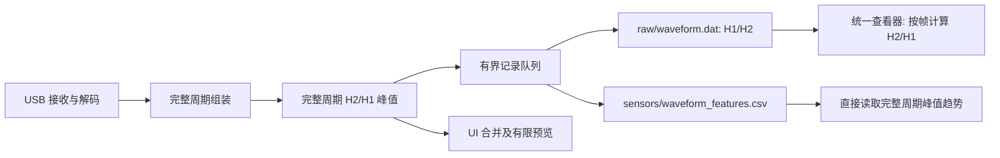

# FPGA H1/H2 接入统一 Session

2026-10-20：以接收端完整 DLIA 周期为记录单位，复用直连 Session 的包结构、生命周期、存储故障处理和查看器。完整记录所在端仍是实际连接 USB 的本机或 SkyCore；地面远程模式收到的有限预览不能替代天空端完整记录。

## 改造对比

| 方面 | 原有直连架构 | 改造前 FPGA 接入 | 当前 FPGA 接入 |
|---|---|---|---|
| Session 生命周期 | 初始化包、开始、暂停、恢复、关闭、manifest | 复用生命周期，增加独立协议档案 | 继续复用同一套生命周期 |
| 完整波形 | `raw/waveform.dat`，source=5/type=1，原始信号和谐波 float32 字节 | `raw/fpga_vlp1.dat`，source=8，USB 块和完整帧重复保存 | 同一个 `raw/waveform.dat`，source=5/type=2，H1/H2 成对保存 |
| 保存内容 | 直连原有信号及谐波 | USB/VLP1、命令、ADC RAW、H1/H2/IQ、JSONL 摘要 | H1/H2；不保存 FPGA 通信字节、ADC RAW、I/Q、独立 JSONL |
| 数值精度 | 沿用 float32 和原字节序标记 | 协议保留 int32，回放临时转换 float32 | 已有 H1/H2 保留 int32；IQ-only 合成幅值保存 float64 |
| 归一化波形 | 沿用原直连处理，不重复添加 H2/H1 | 实时计算；打开档案时重组并生成所有分量的临时样本文件 | 按需从当前帧 H1/H2 计算 H2/H1，重绘复用界面当前帧样本 |
| 峰值 | 原直连峰值及 `waveform_peaks.csv`；Sky 另有特征 CSV | UI 算峰；远程预览可能漏峰，无独立持久化归一化峰值 | 每个周期的归一化峰值、位置、质量写入 `waveform_features.csv`；预览携带完整周期峰值 |
| 记录入口 | 原接收链路 | 原始包旁路保存，UI 周期合并 | 完整周期信号位于 UI 合并和预览抽稀之前 |
| 两路/不同点数 | 原直连帧结构 | 回放按协议 source 区分 | 每条记录包含通道、采样率、实际点数、周期和分段；两路独立时间轴 |
| 配置和时间 | 标准 config、manifest、host 时间 | 独立 JSON 快照、host 与 FPGA tick | 标准 config/manifest/事件日志；每周期同时带 host 时间及 FPGA tick |
| 查看与导出 | 独立数据查看器、原始数据解析页 | 独立协议回放/导出分支 | 新记录复用现有数据查看器和原始解析导出；旧档案读取兼容 |
| 故障边界 | 写入/flush 故障标记 incomplete | 有界队列，协议档案故障标记 incomplete | 有界队列，短写/溢出/flush 故障标记 incomplete；暂停/结束排空 |

传感器测量仍复用现有传感器 CSV 字段与快照流程，本次未扩展传感器字段或增加定标/拟合功能。旧 `waveform_peaks.csv` 仍用于直连缓存；FPGA 正式特征按通道、分量、算法和波形序号读取，避免混用。

## 新记录的数据流

归一化定义为 `max_i(H2[i]/H1[i])`，不使用“两条波形各自峰值之比”。H1 非正、非有限或 H2 非有限的点留断点，不参与统计。整周期没有有效参考时峰值为空，索引为 -1。缺片、溢出、连续性错误的周期只保存质量标记，不拼接跨段分片，不填零冒充真实采样。

## 文件和格式

`VVRAWDAT` 外层仍为 v2，20 字节文件头、36 字节记录头。直连记录 type=1 不变；新增的 harmonic-pair 记录 type=2，外层 source=5、flags=0，sequence 在共用文件内递增，host timestamp 为 epoch 微秒。

type=2 的 payload 固定 48 字节头，全部小端：

| 字节偏移 | 类型 | 含义 |
|---|---|---|
| 0 / 2 | uint16 / uint16 | payload 版本 1 / 头长 48 |
| 4 / 6 | uint16 / uint16 | 通道 0x30 或 0x31 / sample type 1=int32、2=float64 |
| 8 / 12 | uint32 / uint32 | cycle id / 采样率 Hz |
| 16 / 20 | uint32 / uint32 | 完整周期点数 / 实际存储点数 |
| 24 / 32 | uint64 / uint64 | FPGA tick / segment id |
| 40 | uint32 | 周期质量标记 |
| 44 / 46 | uint16 / uint16 | 输入 format / reserved=0 |
| 48 起 | 成对样本 | H1,H2,H1,H2…；不附加归一化数组 |

format0/2 保留 FPGA 给出的 int32 H1/H2；format1 以 `hypot(I1,Q1)`、`hypot(I2,Q2)` 合成两阶幅值后保存 float64。FPGA tick 频率 100 MHz，不能当 UTC；host time、tick、segment 和外层 sequence 分别保留。坏周期 stored_points=0，读者用 original_points 表示缺测范围。

`waveform_features.csv` 保留原有前 14 列，追加 `source,component,algorithm_version,cycle_id,segment_id,fpga_tick,waveform_sequence`。FPGA 行使用 source=`fpga`、component=`H2/H1`、algorithm_version=1，统计以 double 计算并保留 17 位有效数字。完整周期搜索范围为 `[0, 点数)`，CSV end=0 表示帧末尾。算法、无效参考规则、质量 bit 定义同时写入 `waveform_processing` 元数据。

质量位：1=存在无效参考，2=没有有效点，4=周期不完整，8=溢出，16=连续性错误。存在部分无效参考时仍保存其它有效点的峰值；坏周期不生成有效峰值。

初始 FPGA 配置位于 `config/device_config.json`。连接、配置、操作完成、暂停恢复快照写入既有 `logs/event_log.csv`，消息以 `fpga.snapshot` 开头并携带 segment_id。固件状态事件保留当前分段号，连接/配置/记录边界推进分段号。

## 兼容和验证

- 新查看器继续读取旧直连 DAT、旧 waveform 分段和旧 FPGA VLP1 档案；不会转换或覆盖已有 Session。
- 新格式通过明确的 record type 和 payload 版本区分，旧程序不保证能打开新 FPGA 记录，应使用本次更新后的查看器。
- 默认峰值趋势读取保存的特征；切换 H1/H2 或修改搜索范围时后台读取对应帧计算，支持取消。
- 回归覆盖：整数精度、IQ-only、两路/变长帧、无效参考、坏周期、暂停恢复后的重复 cycle id、峰值被预览抽稀漏掉、记录数量、写入/flush/队列溢出故障、并发生命周期、旧档案回放。
- 软件测试不替代 GP01/Cypress 实机吞吐和丢点验收。
