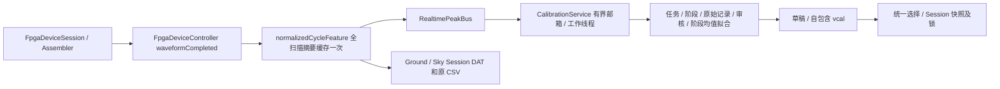

# 独立双波长水汽定标

水汽定标以独立任务和浓度阶段组织数据，不再以导入普通 Session 为入口。定标不启动 Session、不生成临时 Session、不读取 waveform_features.csv 作为实时来源。当前模型仍为流程验证用 C=aR+b，输出未进行温压补偿的初始浓度；模拟数据不能作为仪器精度证据。

## 用户操作

1. 主侧栏打开“水汽定标”，在“任务与采集”填写名称、统一单位并创建任务。支持 ppmv、mol/mol、mg/m³（文件内部 mg/m3），同一任务不混用单位。
2. 添加多个已知浓度阶段，填写时长和备注。默认每阶段 600 秒，即 10 分钟有效时间。不强制预设浓度，允许同浓度重复阶段和调整顺序。
3. 连接本机 FPGA，或连接拥有 FPGA 的 SkyCore，使两路 DLIA 均产生完整有效周期。固定映射为 **816 nm=DLIA1/0x31，1368 nm=DLIA0/0x30**。缺少任一路数据、设备离线、已有定标采集或存在录制/暂停的 Session 时不能开始。
4. 通入该阶段标气，人工等待稳定，勾选稳定确认，再点击“确认稳定，开始 / 继续采集”。没有自动稳定判断，不自动进入下一浓度阶段。
5. 查看有效/剩余时间、墙上耗时、两路有效/质量无效数、最近峰值和实时趋势。切换页面不停止后台采集。到时阶段完成；换气并重新确认稳定后开始下一阶段。
6. 暂停可继续；主动停止保留原始数据并标记“未完成”。已经开始的阶段不能直接修改浓度/时长，可以废弃并新建阶段重采，废弃阶段保留历史。
7. “审核与拟合”按阶段、波长查看时间序列。蓝点有效、灰点人工排除、红点质量无效。单击查看记录及审核历史，拖动框选或选多行后填写原因并批量排除；恢复也追加审核记录。两路审核相互独立，恢复不能绕过系统质量规则。
8. 点击“双波长拟合”。先对完整阶段分别计算有效峰值均值，再以各阶段代表点进行等权普通最小二乘。重复浓度阶段是独立点，周期多的阶段不会自动加权。至少两个不同浓度水平；仅两个水平时警告，建议至少三个。图显示阶段均值和标准差，标准差不作为权重。
9. 检查两路公式、系数、阶段数、浓度水平数、R²、RMSE、残差和适用范围。审核或采集改变修订后原拟合失效，必须重新拟合。
10. “定标文件管理”填写中文文件名并生成 .vcal。同名增加序号，不覆盖旧版本。可复制/另存为、归档、删除、创建修订任务。外部文件先导入安装目录，再选择用于测量。
11. 连接前后均可选择有效文件；设备身份不同必须核对并明确确认。实时显示两路初始浓度，超出峰值范围无效、不外推。
12. 正式录制前必须选择有效双波长文件。开始后由服务锁定；暂停/恢复仍沿用原参数。停止并排空写入队列后解锁。

## 有效时间、中断和恢复

使用单调时钟，只累计两路有效周期共同覆盖的时间。断线、身份变化、质量无效周期、遥测摘要序号缺口、超过 2 秒缺少某路有效周期或邮箱溢出时暂停。2 秒是链路健康超时，不是气路稳定判据。重新核对并确认稳定后继续，不补计缺失时间。

草稿独立自动保存，采集时约每秒一次。基础检查点为 `.vcaldraft`，采集中的新增周期保存在同名 `.vcaldraft.parts/` 目录的原子增量片段；恢复会校验片段顺序、前向摘要、基础文件身份、原始记录、审核日志和统计。备份或移动未结束任务时必须同时保留基础文件和整个 `.parts` 目录，不要单独删除片段。旧版没有片段目录的草稿仍可读取。创建、阶段边界、暂停、审核和正常退出将完整任务写成新检查点，再清理旧代片段；最终 `.vcal` 仍是独立文件。

强制结束采集或保存进程后，恢复边界为最近一次成功提交的完整检查点及连续增量片段。未提交的原子临时文件不作为成功保存；已提交片段损坏时明确拒绝恢复并保留文件，不静默跳过。断电仍可能丢失最近提交的数据，QSaveFile 不承诺硬件断电持久性。恢复重建记录 ID 集合，避免已保存周期重复累计，不补算停机时间。已有任务不能混入不同身份的设备，更换设备应新建任务。

Ground 的持久化 Session 锁在重启时从嵌入快照恢复，不因 UI 重启解锁。确认旧会话已停止后，在文件页明确结束异常会话。远程应先停止天空端 Session。SkyCore 在录制根保存 .calibration-session-lock.json，重启报告暂停/待处理，必须明确停止异常会话再新建；不会把丢失的写入区间伪装为连续恢复，异常历史保留 incomplete 状态。

## 数据模型与文件

生产根目录唯一为 QCoreApplication::applicationDirPath()/calibrations/，与工作目录、普通录制目录、AppData 无关。测试显式注入临时安装根。

```text
<安装目录>/calibrations/
  用户命名.vcal
  用户命名 (2).vcal
  selection.json
  archive/<唯一ID>_旧版本.vcal
  drafts/
    task_<任务UUID>.vcaldraft
    session_lock.json
```

.vcal 为 UTF-8 JSON，自包含原始记录，无外部 CSV 引用。当前 envelope schema=1，字段为 kind=vaporview_calibration、schema_version、file_id、created_utc、project、sha256；草稿 kind=vaporview_calibration_draft，扩展名 .vcaldraft。

CalibrationProject 保存 UUID、名称、统一单位、创建时间、软件版本、来源、父文件 ID、数据修订、设备身份、固定映射、算法/模型/补偿版本、浓度阶段和两路拟合。ConcentrationStage 保存 UUID、浓度、备注、目标/有效/墙上时长、状态、开始/完成时间、两路原始样本、独立追加审核日志和统计。

样本保留流 ID、唯一记录 ID、主机 UTC 微秒、FPGA tick/cycle/segment/sequence、通道、峰值/位置、有效点数、质量、设备身份和传感器来源。所属任务/阶段由容器明确引用。64 位计数保存为十进制字符串。审核记录包括对象、排除/恢复状态、原因、操作 UTC 和修订，不删除原始记录。

统计包括原始、质量有效、自动无效、人工排除、参与统计数量、均值、样本标准差、最小/最大。每路 StageFit 保存参数 ID、生成时间、数据修订、阶段 ID、离散程度、系数、残差、R²/RMSE、适用范围和警告。加载不仅核对 SHA，还从原始样本和审核操作核对阶段统计及拟合。缺少一路、过期修订、错误映射、未知 schema 或无效数值拒绝正式使用。

envelope sha256 校验去掉该字段后的 Qt 紧凑 JSON；Session 的 file_sha256 则追溯原 .vcal 字节。摘要用于一致性校验，不是身份签名。QSaveFile 禁用直接写入回退，目录写锁防止并发写入；成品拒绝覆盖。schema 1 单文件上限 256 MiB。采集按检查点、片段及尚未落盘的完整记录估算容量，达到保守的 240 MiB 预算时拒绝新周期并明确暂停，保留此前全部原始数据；接近上限的已有文件仍可读取，但不能继续采集。不要通过删除原始记录来腾空间，应保留当前草稿，为后续测量新建较短任务。超限、磁盘或权限问题报错，不改存其他目录。JSON 大文件会产生数倍于文件大小的内存开销，实测容量与耗时见架构验证记录。

## FPGA 处理和线程边界



公共归约函数逐点复用 normalizedSecondHarmonic()，取 max(H2/H1)，不是 max(H2)/max(H1)。UI 抽稀预览不参与采集。部分参考点无效仍按原规则跳过，其他有效点可以产生峰值；不完整、溢出、连续性错误周期不能参与统计。

服务由主窗口持有，页面只提交命令和呈现状态；文件、拟合和草稿工作在服务线程执行。峰值邮箱上限 4096，命令队列上限 32。溢出明确暂停。正常退出先停止生产者，再排空处理和写入。历史只读任务使用带 QObject 生命周期和请求序号的异步回调。

远程真实拓扑为“设备 ⇄ FPGA ⇄ SkyCore ⇄ 遥测/IPC ⇄ VaporView”。SkyCore 独占 USB，先记录完整周期，再通过主机遥测 FpgaCycleFeature 转发同一摘要。转发有界并携带流 UUID/序号，串口拥塞可以丢弃摘要以保护控制结果；Ground 检出缺口时暂停，不能用预览代替。带宽不足应降低周期速率或使用 TCP。

FPGA 协议、raw/waveform.dat 原始编码、21 列 waveform_features.csv 及无关 PPK 功能不变。无缓存的历史调用者仍使用同一归约函数。

## 浓度、Session 快照与历史查看

实时页面复用原 calculate()；Ground 和无 UI Sky 录制复用同一线性预测/范围校验函数，从所选 .vcal 获取各自参数。没有外推或温压补偿。

每个正式 Session 新增 calibration_snapshot.json（原文件 ID/SHA、文件名、任务及设备元数据、固定映射、软件/schema/模型/峰值算法版本、两路全部参数/范围/指标/单位、运行参数摘要）及 calibration_concentrations.jsonl（每周期来源、质量、初始浓度或原因、原文件/参数、未补偿状态、行摘要）。Ground 还嵌入完整 vcal；远程命令传递完整数值及元数据快照，不传庞大的原始定标样本。

异常重启不会自动解锁。若持久化锁中的文件身份、运行参数与完整快照不一致，页面保留锁并明确报错，停止浓度计算；应先保留历史文件排查，再明确结束异常会话，不能靠切换文件或重启绕过校验。远程 Start 未收到 ACK 时仍保留 Ground 预备锁，应重连核对 Sky 实际录制状态后再操作。

独立数据查看器“查看本 Session 定标参数与初始浓度”显示原参数、总条数和前 200 条，可导出全部浓度及参数。定标文件页也能打开 Session JSONL/快照与历史导出。读取核对原参数、质量及计算结果，不查询当前选择。原 .vcal 删除、移动或重命名后仍可读。异常退出造成未写完尾行时明确报错，不静默接受损坏内容。

## 温压与兼容

保留 FPGA PTB210/HMP、本地串口温压和远程环境数据的原单位、有效性、可用 tick/源主机时间及接收 UTC。仅关联接收时间窗口内记录，标记 host_receipt_uncertain；真实传感器采样 UTC 未知为 null，不冒充精确同期值，不用零值或过时值填充。正式温压补偿公式尚未提供，本次未实现补偿。

旧 library.json schema v1/v2、Dataset、Fit 和浓度快照适配器保留，不删除原库。显式“导入旧库参数”指定两路原始 Fit ID，保留原系数/通道/范围/来源，标记 legacy_import；不伪造原采集阶段和时长。单位/固定映射不兼容时禁止用于当前录制，历史仍按原版本读取。旧 v1 浓度快照需要原库版本；旧 v2 自包含快照继续独立可读。旧 Session 导入式页面交互已全部替换。

## 安装、验证与实机交接

IFW 创建 calibrations 与 drafts，不将用户文件放入 payload。安装器显式设置 `RemoveTargetDir=false`，避免 IFW 默认递归删除整个安装根；按此策略全新安装后，卸载只撤销包文件和空目录，保留非空用户目录。已有权限工具为发起安装的交互用户 SID 授予可继承 Full Control，覆盖新增目录；不向 Everyone 授权，不要求管理员运行应用。便携版使用所在目录权限，写失败提示检查空间/权限或安装器修复，没有 AppData 回退。参见 [Windows 权限模型](windows_permissions.md)。

旧安装器没有这个设置，其维护工具可能已经保存强制删除安装根的撤销记录；仅更新应用或维护工具不能保证消除该记录。旧安装卸载前，必须将整个 `calibrations`（包括 drafts 和 `.parts`）及 `data` Session 历史复制到安装目录之外并确认备份可读。随后卸载旧安装，用本次安全策略的安装包全新安装，再恢复这些目录。不要把旧维护工具的卸载当成安全保留数据的路径。

本机隔离中文目录的 IFW 安装、维护工具/核心升级、卸载、重装和再次卸载已验证各阶段 25 个用户文件 SHA 一致，定标、草稿和 Session 历史可读；也验证了受限令牌的中文文件读写。这使用当前载荷及模拟版本元数据，不代表历史发布安装器的原地迁移验收。架构调查、测试矩阵及真实交付结果见 [架构与验证记录](water_calibration_architecture.md)。所有合成 FPGA 数据和虚拟时钟均为软件验证。

实机仍需检查：实际 USB/驱动与固定光路，H1/H2 格式和质量标志；真实速率下每阶段 10 分钟、多阶段容量、保存耗时、串口/TCP 丢帧及断线/断电恢复；PTB/HMP 单位、时钟和对齐误差；可溯源标气与正式模型/温压补偿/精度验收；目标普通用户的安装、更新、卸载及用户文件保留。本机隔离安装和 ACL 测试不能代替目标机 UAC/实机验证，真实物理磁盘写满也尚未执行。
