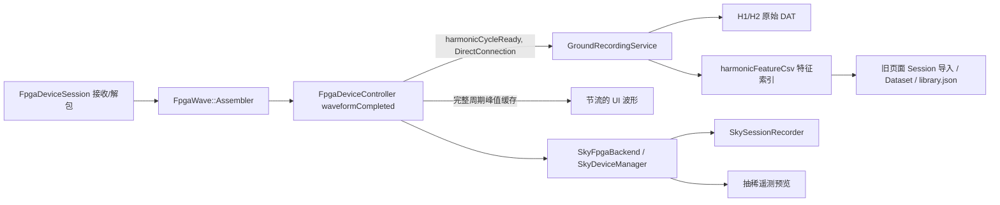
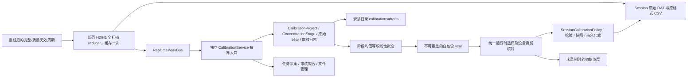

# 独立水汽定标架构

调查基线：`origin/main` = `43df0662c30f7906fd2f9e7cd2f1d4ddb3549a49`。

## 原链路

`CompletedStream` 区分 source、cycleId、timestamp tick、firstHostTimeUs、complete、partial、overflow、continuityError 和 preview。旧 UI 预览不是采集数据源。旧峰值存在 controller、DAT 特征索引重复计算。

## 新模块边界

固定光路：816 nm=DLIA1/0x31；1368 nm=DLIA0/0x30。质量 bit 与历史格式保持一致；InvalidReference 只表示部分参考点被跳过，其余有效点的全扫描最大值仍可用。不完整、溢出、连续性错误不得进入统计。

保留 `WaterCalibration` 的线性计算、质量策略、旧库 v1/v2 与 `ConcentrationResults` 的历史快照读取。新任务不以 Dataset 为顶层；只在兼容边界和现有 calculate 参数桥接处接触旧类型。旧页面所有 Session 导入式交互被替换。阶段数据与原始记录永久保留；人工审核作为独立追加日志，数据修订使拟合失效。

采集有效时间以两路有效周期时间窗口的交集累计，间断不补时；设备断开/用户暂停自动保存，恢复要求重新确认稳定及设备身份。后台服务由主窗口持有，页面切换不影响其生命周期。传感器无可靠采样时间时标记不可用/host receipt uncertain，禁止伪造同期值。

文件使用 Qt JSON、QSaveFile 和 SHA-256，无新增归档依赖。生产目录只从 applicationDirPath 解析。已有 IFW 权限工具对选定安装根执行 apply/verify；更新不得把用户 calibrations 作为 payload 或删除目标。完整交付与验证结果见 `water_calibration.md`。

## 实时入口、远程传输和生命周期

完整 DLIA 周期由 `FpgaDeviceSession` 的 assembler 产生，`FpgaDeviceController::waveformCompleted` 用 `normalizedCycleFeature` 缓存规范特征，再发 `harmonicCycleReady`。同一周期的 Session CSV、独立定标和 SkyCore 遥测都消费缓存；没有缓存的旧载荷走同一个 reducer。不是 `max(H2)/max(H1)`，也不读取显示抽稀点。

`RealtimePeakBus` 用带 QObject 接收上下文的连接管理订阅生命期；连接身份/segment、源通道、tick、cycle 去重，4096 条去重窗口。每条记录含流 UUID、序号和稳定 SHA 标识。主窗口拥有 bus 和 `CalibrationService`；页面销毁或隐藏不结束采集。退出先关闭 FPGA 生产者，再排空记录服务和定标服务。

实际远程路径为设备 → FPGA → SkyCore → 遥测 → Ground。SkyCore 将相同完整周期摘要通过新增主机遥测类型 `FpgaCycleFeature=0x12` 发送；没有更改 FPGA/VLP1 协议。发送邮箱上限 4096，序号缺口及流变更转成连续性错误；不能用已有 waveform preview 补足缺失周期。SkyCore 状态转发连接时的 backend/locator/USB 身份。实时完整周期仍优先写入 Sky 原始记录，显示与慢遥测不会反压 USB 生产者。

## 模块与旧代码处置

| 模块 | 职责 |
| --- | --- |
| CalibrationProject / ConcentrationStage / PeakRecord | 多阶段、统一单位、原始来源、修订、追加审核日志、双波长统计 |
| RealtimePeakBus | 完整周期的共享特征、稳定标识、去重、设备通知、远程序号检查 |
| CalibrationService | 有界邮箱、独立工作线程、有效/墙上时间、草稿恢复、文件选择、传感器关联、持久化 Session 锁 |
| CalibrationFileStore | 安装根路径、不可覆盖文件、QSaveFile、双层 SHA、完整读取与重新拟合校验 |
| CalibrationReviewPlot / CalibrationFitPlot | 点击/框选审核、趋势、阶段均值与标准差；显示可抽稀，选择/统计保留全部样本 |
| SessionCalibrationPolicy / CalibrationRuntime | Ground 开始前准入、绑定、停止释放；Ground 与 Sky 共用预测及质量规则 |
| RecordedConcentrations | 独立 Session 参数/结果读取、重新核对和自包含导出 |
| WaterCalibrationPage | 三个工作区的命令与呈现，替换旧 Session/Dataset 导入页面 |

保留 `WaterCalibration` 的线性模型注册、calculate 质量策略和 `ConcentrationResults` 的 v1/v2 读取。Dataset/Fit 只用于旧数据兼容和已有 calculate 参数桥接。没有删除旧库文件或旧历史解析器。旧页面导入 Session、Dataset 下拉和旧槽函数已删除，没有两套正式运行入口。新业务拟合输入是完整阶段的均值，每阶段等权，重复浓度阶段独立保留；拟合失败按波长报告，两水平显示质量警告。

## 数据与文件契约

任务含 UUID、名称、单位、创建时间、软件版本、设备身份、固定通道映射、origin、修订号、阶段和两路拟合。阶段保留浓度、设定/有效/墙上时长、状态、起止 UTC、备注、两路原始记录、统计和审核日志。原始记录显式保存原采集 task_id/stage_id；修订任务保留原记录来源，不篡改原峰值。审核操作保存记录 ID、状态、原因、UTC、修订；系统质量无效点不能通过恢复操作绕过。

文件是 UTF-8 Qt JSON，envelope schema=1，kind 区分成品与草稿。内部摘要校验去掉 sha256 后的 Qt Compact JSON；选定文件的 SHA-256 针对实际字节，进入 Session 参数快照与每条结果。读取校验字段、类型、固定映射、单位、来源、统计、审核和重新拟合结果。默认根为 applicationDirPath()/calibrations，草稿在 drafts；文件名支持中文和空格，保留字/非法字符规整，重名加序号，原子提交禁用直接覆盖回退。单文件当前上限 256 MiB，超限明确报错并保留草稿，不切换目录。

文件详情只呈现元数据、统计和原始记录数量；审核样本每页 500 条；历史预览前 200 条，导出仍包含全部数据。文件/历史读取与拟合运行在服务线程或带请求序号和 QObject 上下文的异步任务，过时回调不能覆盖新请求。

## 运行、异常恢复与部署

设备前后均可选择文件；设备身份不同要求核对确认，固定映射不符直接拒绝。实时初始浓度可在无 Session 时计算，链路无数据后清除有效显示。正式录制准入重新读取原文件，要求已连接、有效双波长参数及无其他采集/未结束会话。Ground 写入完整 vcal 加紧凑 runtime，远程命令只传完整参数和元数据，避免原始定标样本挤占控制通道。

Ground 和 Sky 均在正式录制开始前持久化定标锁。暂停及恢复不换参数。异常重启保留锁，用户明确结束后将旧会话标记 incomplete、保留原清单计数及快照，再释放锁；不把中断区间伪装为连续恢复。原 vcal 删除后历史仍按原快照读取，当前选择不会覆盖历史。

IFW core 创建 calibrations/drafts，沿用安装根交互用户 SID 的可继承 ACL。用户目录不作为 payload，也没有递归删除或替换操作；非空目录在卸载时保留。权限不足明确要求检查空间/目录权限或使用安装器修复，不要求以管理员运行应用，不授予 Everyone，也不转存 AppData。普通用户目标机 UAC/升级/卸载仍须现场验证。

## 软件验证范围与硬件交接

新增独立采集测试采用明确标注的软件 FPGA 数据与可注入单调时钟。覆盖默认 600000 ms、双路公共窗口、暂停墙上耗时、断线/无效周期/远程序号缺口、重复周期、草稿重启、订阅销毁、互斥、不可写目录、中文文件、摘要/schema/映射、人工审核和阶段均值等权拟合。端到端测试包含 Ground 和 Sky 参数准入、暂停锁定、异常重启锁、双路浓度、无外推、未补偿、原文件删除后的历史读取/导出及篡改拒绝。旧定标测试继续覆盖历史库和快照。

实际 Qt 渲染检查了三工作区、浅/暗主题、100%/130%、主窗口缩窄及独立数据查看器。发现并修正暗色详情视口和交替行对比度；截图代码、图片和测试配置仅用于临时验证，不进入版本库。

全部证据均为本机软件构建、模拟、临时文件和 Qt 渲染。未接实机，不构成 FPGA/USB 驱动、真实速率、标气浓度、仪器精度或温压补偿验证。现场清单见操作文档，尤其需要真实双路每阶段十分钟、多阶段容量、丢帧/断电、PTB/HMP 时间与单位、普通用户安装升级保留用户文件检查。

## 本轮验证与基线对照

验证始终使用 `build/Release`，地图开关保持 ON。Windows 命令在 VS Developer 环境运行，初始化前使用 UTF-8 代码页。最终代码执行 `cmake -S . -B build/Release` 及 `cmake --build build/Release --config Release -- -j4` 成功；提交本身不改变构建输入，不重复重建。

新增 `independent_calibration_test`，重写 `water_calibration_ui_test` 和 `water_calibration_e2e_test`；三项最终聚焦回归全部通过。UI 测试还直接检查 Qt 实际渲染的明暗对比；FPGA 正式录制 UI 测试改用隔离安装根和明确的软件测试定标参数，没有放宽生产准入条件。

为区分既有失败，临时按字节备份工作区文件，在同一个 `build/Release` 构建原始主线 `43df0662`，运行 8 项对照，再逐文件校验恢复本次实现。原版中 `fpga_main_window_test`、`fpga_local_simulator_test` 和 `main_window_layout_test` 通过，下列 5 项失败与首次全量中的表现一致：

| 原始主线失败项 | 对照症状 |
| --- | --- |
| segmented_switch_button_test | 温控胶囊状态断言 |
| home_appearance_layout_test | 窄窗口卡片排列断言 |
| device_config_layout_test | 远程 FPGA Direct 预设保护断言 |
| ui_test_mode_window_test | 温控胶囊绿色渲染断言 |
| map3d_real_window_close_test | missing.osgb 路径场景崩溃，并有 Fontconfig 提示 |

这些问题不因本次定标改造扩大修复范围。定标采集、正式参数准入和历史独立读取均另有直接回归；不能用主线存在失败推断新增功能通过。

2026-11-03 最终验证结果：

| 验证 | 实际结果 |
| --- | --- |
| 完整 `ctest --test-dir build/Release --output-on-failure` | 156 项，146 通过、9 失败、1 跳过；1393.34 秒，CTest 非零退出 |
| 本地模拟器补齐有效软件 `.vcal` 后复测 | `fpga_local_simulator_test` 通过，49.18 秒；原测试点击正式录制后停在缺少定标文件的提示框，生产准入没有放宽 |
| 同一构建的间歇失败复测 | `epsilon_config_panel_test`、`session_viewer_trajectory_test`、`main_window_map3d_open_test` 全部通过，分别 6.72、8.94、19.07 秒；未修改这些功能来规避断言 |
| 按每项最新有效结果汇总 | 150 通过、上述 5 项主线对照失败、1 跳过；这不是一次全量全绿结果 |
| 定标 6 项 | 独立采集、旧模型/完整性、新页面、Ground/Sky 端到端、旧联合模型全部通过，合计 7.04 秒；包含批量审核、均值/样本标准差、原始记录和审核文件往返 |
| FPGA 与主窗口 | `fpga_main_window_test` 95.16 秒、`main_window_layout_test` 79.63 秒通过；协议、重组、模拟器、SkyCore、归档、正式录制 UI 和首页波形相关测试通过 |
| 历史与周边链路 | PPK、Session 核心、查看器主题/读写/窗口状态、实时 3D、应用启动通过；完整结果中的轨迹滚动条和地图打开耗时断言按上行记录聚焦复测 |
| 安装和权限 | `manifest_policy_test`、`permission_tool_test`、`ifw_staging_test` 通过；`node tests/ifw_maintenance_operations_test.js` 的 Windows/Linux 目录保留检查通过 |
| 跳过项 | `update_relauncher_elevated_parent_test` 按测试约定跳过，当前进程未提升权限 |

最后的测试修改仅补充隔离软件定标文件和审核断言，相关测试目标已在 `build/Release` 重建，最终全目标构建再次成功。没有改变已验证的生产构建输入；复用完整回归与对应聚焦复测，不将复测通过掩盖为原始完整运行全绿。

离线安装包验证使用 `scripts/package-ifw-windows.ps1 -SkipBuild -NoRepository`，IFW 4.8.1，命令退出码 0。生成本地 `build/Release/ifw-calibration-verification/VaporView-1.0.23-win64-setup.exe`（118785985 字节），SHA-256 为 `A055032BAA3D036672B493E919EB3EFD48C34A1FA4DA7B3F00A08B966468884E`；staging 的主程序、Sky/SkyCore/SkyTui、更新重启工具和权限工具共 6 个可执行文件均与最终 Release 文件 SHA 一致。沿用当前软件版本，仅验证离线包，没有发布更新仓库或在线安装包。目标机普通用户安装、更新和卸载尚未执行。

同时核对了 Qt IFW 4.8 分支的 [Mkdir 撤销实现](https://github.com/qtproject/installer-framework/blob/4.8/src/libs/kdtools/updateoperations.cpp#L500) 和 [完整卸载的非强制目录删除处理](https://github.com/qtproject/installer-framework/blob/4.8/src/libs/installer/packagemanagercore.cpp#L957)：默认目录撤销不会强制删除用户文件。项目没有为 calibrations 设置强制删除，也没有添加移除操作。该源码检查支持保留策略，不能代替目标机升级/卸载实测。
