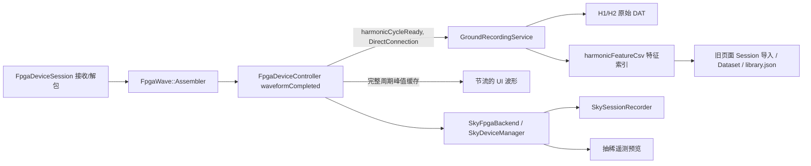
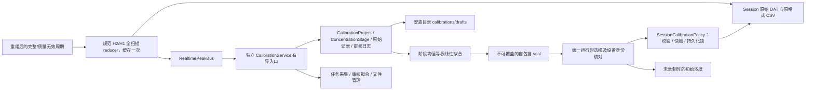

# 独立水汽定标架构

调查基线：`origin/main` = `43df0662c30f7906fd2f9e7cd2f1d4ddb3549a49`。

## 原链路

`CompletedStream` 区分 source、cycleId、timestamp tick、firstHostTimeUs、complete、partial、overflow、continuityError 和 preview。旧 UI 预览不是采集数据源。旧峰值存在 controller、DAT 特征索引重复计算。

## 新模块边界

固定光路：816 nm=DLIA1/0x31；1368 nm=DLIA0/0x30。质量 bit 与历史格式保持一致；InvalidReference 只表示部分参考点被跳过，其余有效点的全扫描最大值仍可用。不完整、溢出、连续性错误不得进入统计。

保留 `WaterCalibration` 的线性计算、质量策略、旧库 v1/v2 与 `ConcentrationResults` 的历史快照读取。新任务不以 Dataset 为顶层；只在兼容边界和现有 calculate 参数桥接处接触旧类型。旧页面所有 Session 导入式交互被替换。阶段数据与原始记录永久保留；人工审核作为独立追加日志，数据修订使拟合失效。

采集有效时间以两路有效周期时间窗口的交集累计，间断不补时；设备断开/用户暂停自动保存，恢复要求重新确认稳定及设备身份。后台服务由主窗口持有，页面切换不影响其生命周期。传感器无可靠采样时间时标记不可用/host receipt uncertain，禁止伪造同期值。

文件使用 Qt JSON、QSaveFile 和 SHA-256，无新增归档依赖。生产目录只从 applicationDirPath 解析。已有 IFW 权限工具对选定安装根执行 apply/verify；更新不得把用户 calibrations 作为 payload 或删除目标。完整交付与验证结果见 `water_calibration.md`。

## 实时入口、远程传输和生命周期

完整 DLIA 周期由 `FpgaDeviceSession` 的 assembler 产生，`FpgaDeviceController::waveformCompleted` 用 `normalizedCycleFeature` 缓存规范特征，再发 `harmonicCycleReady`。同一周期的 Session CSV、独立定标和 SkyCore 遥测都消费缓存；没有缓存的旧载荷走同一个 reducer。不是 `max(H2)/max(H1)`，也不读取显示抽稀点。

`RealtimePeakBus` 用带 QObject 接收上下文的连接管理订阅生命期；连接身份/segment、源通道、tick、cycle 去重，4096 条去重窗口。每条记录含流 UUID、序号和稳定 SHA 标识。主窗口拥有 bus 和 `CalibrationService`；页面销毁或隐藏不结束采集。退出先关闭 FPGA 生产者，再排空记录服务和定标服务。

实际远程路径为设备 → FPGA → SkyCore → 遥测 → Ground。SkyCore 将相同完整周期摘要通过新增主机遥测类型 `FpgaCycleFeature=0x12` 发送；没有更改 FPGA/VLP1 协议。发送邮箱上限 4096，序号缺口及流变更转成连续性错误；不能用已有 waveform preview 补足缺失周期。SkyCore 状态转发连接时的 backend/locator/USB 身份。实时完整周期仍优先写入 Sky 原始记录，显示与慢遥测不会反压 USB 生产者。

## 模块与旧代码处置

| 模块 | 职责 |
| --- | --- |
| CalibrationProject / ConcentrationStage / PeakRecord | 多阶段、统一单位、原始来源、修订、追加审核日志、双波长统计 |
| RealtimePeakBus | 完整周期的共享特征、稳定标识、去重、设备通知、远程序号检查 |
| CalibrationService | 有界邮箱、独立工作线程、有效/墙上时间、草稿恢复、文件选择、传感器关联、持久化 Session 锁 |
| CalibrationFileStore | 安装根路径、不可覆盖文件、QSaveFile、双层 SHA、完整读取与重新拟合校验 |
| CalibrationReviewPlot / CalibrationFitPlot | 点击/框选审核、趋势、阶段均值与标准差；显示可抽稀，选择/统计保留全部样本 |
| SessionCalibrationPolicy / CalibrationRuntime | Ground 开始前准入、绑定、停止释放；Ground 与 Sky 共用预测及质量规则 |
| RecordedConcentrations | 独立 Session 参数/结果读取、重新核对和自包含导出 |
| WaterCalibrationPage | 三个工作区的命令与呈现，替换旧 Session/Dataset 导入页面 |

保留 `WaterCalibration` 的线性模型注册、calculate 质量策略和 `ConcentrationResults` 的 v1/v2 读取。Dataset/Fit 只用于旧数据兼容和已有 calculate 参数桥接。没有删除旧库文件或旧历史解析器。旧页面导入 Session、Dataset 下拉和旧槽函数已删除，没有两套正式运行入口。新业务拟合输入是完整阶段的均值，每阶段等权，重复浓度阶段独立保留；拟合失败按波长报告，两水平显示质量警告。

## 数据与文件契约

任务含 UUID、名称、单位、创建时间、软件版本、设备身份、固定通道映射、origin、修订号、阶段和两路拟合。阶段保留浓度、设定/有效/墙上时长、状态、起止 UTC、备注、两路原始记录、统计和审核日志。原始记录显式保存原采集 task_id/stage_id；修订任务保留原记录来源，不篡改原峰值。审核操作保存记录 ID、状态、原因、UTC、修订；系统质量无效点不能通过恢复操作绕过。

文件是 UTF-8 Qt JSON，envelope schema=1，kind 区分成品与草稿。内部摘要校验去掉 sha256 后的 Qt Compact JSON；选定文件的 SHA-256 针对实际字节，进入 Session 参数快照与每条结果。读取校验字段、类型、固定映射、单位、来源、统计、审核和重新拟合结果。默认根为 applicationDirPath()/calibrations，草稿在 drafts；文件名支持中文和空格，保留字/非法字符规整，重名加序号，原子提交禁用直接覆盖回退。单文件当前上限 256 MiB，超限明确报错并保留草稿，不切换目录。

文件详情只呈现元数据、统计和原始记录数量；审核样本每页 500 条；历史预览前 200 条，导出仍包含全部数据。文件/历史读取与拟合运行在服务线程或带请求序号和 QObject 上下文的异步任务，过时回调不能覆盖新请求。

## 运行、异常恢复与部署

设备前后均可选择文件；设备身份不同要求核对确认，固定映射不符直接拒绝。实时初始浓度可在无 Session 时计算，链路无数据后清除有效显示。正式录制准入重新读取原文件，要求已连接、有效双波长参数及无其他采集/未结束会话。Ground 写入完整 vcal 加紧凑 runtime，远程命令只传完整参数和元数据，避免原始定标样本挤占控制通道。

Ground 和 Sky 均在正式录制开始前持久化定标锁。暂停及恢复不换参数。异常重启保留锁，用户明确结束后将旧会话标记 incomplete、保留原清单计数及快照，再释放锁；不把中断区间伪装为连续恢复。原 vcal 删除后历史仍按原快照读取，当前选择不会覆盖历史。

IFW core 创建 calibrations/drafts，沿用安装根交互用户 SID 的可继承 ACL。用户目录不作为 payload；安装器必须显式设置 `RemoveTargetDir=false` 才能阻止 IFW 根目录递归删除。安全策略下的全新安装保留非空用户目录；旧安装保存的强制撤销记录须按操作文档先外部备份、卸载、全新安装后恢复，不能只更新配置就声称迁移安全。权限不足明确要求检查空间/目录权限或使用安装器修复，不要求以管理员运行应用，不授予 Everyone，也不转存 AppData。普通用户目标机 UAC/升级/卸载仍须现场验证。

## 软件验证范围与硬件交接

新增独立采集测试采用明确标注的软件 FPGA 数据与可注入单调时钟。覆盖默认 600000 ms、双路公共窗口、暂停墙上耗时、断线/无效周期/远程序号缺口、重复周期、草稿重启、订阅销毁、互斥、不可写目录、中文文件、摘要/schema/映射、人工审核和阶段均值等权拟合。端到端测试包含 Ground 和 Sky 参数准入、暂停锁定、异常重启锁、双路浓度、无外推、未补偿、原文件删除后的历史读取/导出及篡改拒绝。旧定标测试继续覆盖历史库和快照。

实际 Qt 渲染检查了三工作区、浅/暗主题、100%/130%、主窗口缩窄及独立数据查看器。发现并修正暗色详情视口和交替行对比度；截图代码、图片和测试配置仅用于临时验证，不进入版本库。

全部证据均为本机软件构建、模拟、临时文件和 Qt 渲染。未接实机，不构成 FPGA/USB 驱动、真实速率、标气浓度、仪器精度或温压补偿验证。现场清单见操作文档，尤其需要真实双路每阶段十分钟、多阶段容量、丢帧/断电、PTB/HMP 时间与单位、普通用户安装升级保留用户文件检查。

## 架构重建交付时的验证（历史记录）

验证始终使用 `build/Release`，地图开关保持 ON。Windows 命令在 VS Developer 环境运行，初始化前使用 UTF-8 代码页。最终代码执行 `cmake -S . -B build/Release` 及 `cmake --build build/Release --config Release -- -j4` 成功；提交本身不改变构建输入，不重复重建。

新增 `independent_calibration_test`，重写 `water_calibration_ui_test` 和 `water_calibration_e2e_test`；三项最终聚焦回归全部通过。UI 测试还直接检查 Qt 实际渲染的明暗对比；FPGA 正式录制 UI 测试改用隔离安装根和明确的软件测试定标参数，没有放宽生产准入条件。

为区分既有失败，临时按字节备份工作区文件，在同一个 `build/Release` 构建原始主线 `43df0662`，运行 8 项对照，再逐文件校验恢复本次实现。原版中 `fpga_main_window_test`、`fpga_local_simulator_test` 和 `main_window_layout_test` 通过，下列 5 项失败与首次全量中的表现一致：

| 原始主线失败项 | 对照症状 |
| --- | --- |
| segmented_switch_button_test | 温控胶囊状态断言 |
| home_appearance_layout_test | 窄窗口卡片排列断言 |
| device_config_layout_test | 远程 FPGA Direct 预设保护断言 |
| ui_test_mode_window_test | 温控胶囊绿色渲染断言 |
| map3d_real_window_close_test | missing.osgb 路径场景崩溃，并有 Fontconfig 提示 |

该次架构重建没有处理这五项问题。后续软件质量专项以 `b4e57fc635c8cdc5ceabcf9ee9c2789b71e9d92a` 为基线处理它们；两次验证的结果不得混为一次完整测试结果。

2026-11-03 架构重建阶段验证结果（历史）：

| 验证 | 实际结果 |
| --- | --- |
| 完整 `ctest --test-dir build/Release --output-on-failure` | 156 项，146 通过、9 失败、1 跳过；1393.34 秒，CTest 非零退出 |
| 本地模拟器补齐有效软件 `.vcal` 后复测 | `fpga_local_simulator_test` 通过，49.18 秒；原测试点击正式录制后停在缺少定标文件的提示框，生产准入没有放宽 |
| 同一构建的间歇失败复测 | `epsilon_config_panel_test`、`session_viewer_trajectory_test`、`main_window_map3d_open_test` 全部通过，分别 6.72、8.94、19.07 秒；未修改这些功能来规避断言 |
| 按每项最新有效结果汇总 | 150 通过、上述 5 项主线对照失败、1 跳过；这不是一次全量全绿结果 |
| 定标 6 项 | 独立采集、旧模型/完整性、新页面、Ground/Sky 端到端、旧联合模型全部通过，合计 7.04 秒；包含批量审核、均值/样本标准差、原始记录和审核文件往返 |
| FPGA 与主窗口 | `fpga_main_window_test` 95.16 秒、`main_window_layout_test` 79.63 秒通过；协议、重组、模拟器、SkyCore、归档、正式录制 UI 和首页波形相关测试通过 |
| 历史与周边链路 | PPK、Session 核心、查看器主题/读写/窗口状态、实时 3D、应用启动通过；完整结果中的轨迹滚动条和地图打开耗时断言按上行记录聚焦复测 |
| 安装和权限 | `manifest_policy_test`、`permission_tool_test`、`ifw_staging_test` 通过；`node tests/ifw_maintenance_operations_test.js` 的 Windows/Linux 目录保留检查通过 |
| 跳过项 | `update_relauncher_elevated_parent_test` 按测试约定跳过，当前进程未提升权限 |

最后的测试修改仅补充隔离软件定标文件和审核断言，相关测试目标已在 `build/Release` 重建，最终全目标构建再次成功。没有改变已验证的生产构建输入；复用完整回归与对应聚焦复测，不将复测通过掩盖为原始完整运行全绿。

离线安装包验证使用 `scripts/package-ifw-windows.ps1 -SkipBuild -NoRepository`，IFW 4.8.1，命令退出码 0。生成本地 `build/Release/ifw-calibration-verification/VaporView-1.0.23-win64-setup.exe`（118785985 字节），SHA-256 为 `A055032BAA3D036672B493E919EB3EFD48C34A1FA4DA7B3F00A08B966468884E`；staging 的主程序、Sky/SkyCore/SkyTui、更新重启工具和权限工具共 6 个可执行文件均与最终 Release 文件 SHA 一致。沿用当前软件版本，仅验证离线包，没有发布更新仓库或在线安装包。目标机普通用户安装、更新和卸载尚未执行。

上次源码检查的结论不完整：[Mkdir 撤销实现](https://github.com/qtproject/installer-framework/blob/4.8/src/libs/kdtools/updateoperations.cpp#L500) 的组件级非强制删除，不能覆盖 IFW 默认的安装根强制撤销。[先前引用的代码](https://github.com/qtproject/installer-framework/blob/4.8/src/libs/installer/packagemanagercore.cpp#L957) 实际属于安装失败回滚，并非完整卸载。软件质量专项真实 `purge` 已复现全部用户数据被删除；实际完整卸载见 [runUninstaller / deleteMaintenanceTool](https://github.com/qtproject/installer-framework/blob/4.8/src/libs/installer/packagemanagercore_p.cpp#L2192)，修正及验证在下面单独记录。

## 软件质量专项：实现和恢复边界

本节基线为 `b4e57fc635c8cdc5ceabcf9ee9c2789b71e9d92a`，与上节架构重建的历史测试分开记录。算法、固定光路、FPGA 协议及 Session 格式不变。

### 五项遗留失败

在该基线的原始实现上重新构建并复现五项失败。胶囊和 Direct 预设的测试预期落后于已经合入的产品行为，修正依据如下；没有将生产逻辑改回旧行为。

| 测试 | 根因及处理 | 聚焦验证 |
| --- | --- | --- |
| segmented_switch_button_test | `287bafc` / `b992912` 已改为双通道温控和紧凑开关；旧断言仍要求单通道几何与回调。改为核对两通道、四个 pill 和各自操作 | 通过，1.17 秒 |
| home_appearance_layout_test | 卡片换行使用被子控件最小宽度撑大的 scroll content 宽度，窄窗口实际 viewport 更小；改用可见 viewport 扣除边距后的宽度 | 通过，42.16 秒 |
| device_config_layout_test | `3ddc44e6` 已允许 Direct 模式预选设备，传输配置仍只读；旧测试错误地要求启用复选框也禁用 | 通过，22.10 秒 |
| ui_test_mode_window_test | `b00f91a9` 已改为中性胶囊底色，旧测试仍找绿色；同步核对双通道文案、完整遥测速率标签和 DPR 后的实际像素 | 通过，68.18 秒 |
| map3d_real_window_close_test | 异步加载 watcher 在取消检查之前读取 `result()`；任务尚未启动即取消时没有结果，Release 可崩溃。三个加载器均先检查 shutdown/generation/canceled/resultCount，再访问结果 | 取消回归 1.91 秒、真实窗口关闭 36.42 秒通过 |

地图新增测试用单线程池屏障确定性地排队、取消 Earth/3DTiles/Aircraft 加载，并覆盖窗口先销毁、任务后解除屏障。修复前新测试 1.76 秒即 SEGFAULT；修复后完成回调恰一次或销毁后不回调，没有延迟析构或跳过资源释放。原 `missing.osgb` 失败没有获得符号栈，不能声称已证明它与新复现的栈完全相同。Fontconfig 提示在成功测试中也存在，目前证据仅支持它是伴随警告。

### 实时处理、保存与诊断

`RealtimePeakBus` 保持 4096 条去重窗口，增加分发、重复和连续性计数；规范峰值仍由现有 reducer 缓存。原生特征来源校验直接检查类型化字段，免除每周期 JSON 往返，测试逐项比较其与严格 JSON 解码的规则。

`CalibrationService` 保持 4096 峰值、32 命令上限，每批最多处理 64 项后让出锁；命令带已接收峰值序号屏障，持续输入不能饿死暂停命令，也不能把启动前排队的峰值录入新阶段。峰值携带接收时阶段 ID。溢出立即明确暂停，已接收前缀继续保存为原始记录，不再累计有效时间；未接收部分计入 dropped。退出排空已接收事件并提交暂停检查点。重复 ID 在更新最近有效通道时间之前拒绝。

诊断接口提供输入/处理/有效/无效/重复/丢弃/保存记录/接收后放弃、队列长度及峰值、分通道最大和总体平均/最大处理延迟、入口锁等待、保存次数/失败/最大耗时、自动暂停原因和容量拒绝数。这些保留在诊断接口，没有堆入普通页面。

采集中每秒提交不可覆盖的原子增量片段 `.vcaldraft.parts/<检查点 UUID>_<序号>.vcalpart`，含前一摘要、起始数量、完整元数据/审核/统计及新增原始记录。暂停、编辑、阶段切换、退出保存完整检查点；单片超过 16 MiB 时也回退完整检查点。完整检查点提交后通过新 UUID 使旧代片段失效，再清理旧片段。没有后台周期性重写越来越大的完整任务。保存时释放服务状态锁，允许生产者进入有界邮箱；失败保持明确错误和暂停状态，不显示“已保存”，失败重试节流为一秒。

恢复只接受匹配检查点的一条连续、数量正确的 SHA 链，最后严格校验全任务、记录 ID、设备身份、审核、统计及拟合。未提交临时文件和旧代片段忽略；已提交片段损坏/缺段拒绝打开，所有源文件保留。旧单文件草稿兼容，成品仍是 schema 1 自包含 `.vcal`。采集中检查基文件大小/修改时间变化，异常即暂停；这不是外部攻击的身份认证机制。持久化保证止于最近成功提交的检查点及连续片段；未提交内存不保证恢复，QSaveFile 不提供突然断电后最后一次提交必然落盘的保证。

正式 Session 恢复额外核对外层文件身份、运行参数摘要及 Ground 完整 `.vcal` 重新推导的全部参数；篡改系数后重新计算 runtime 摘要也不能通过。无效恢复保留锁并禁止浓度计算，不能靠重启解除。绑定拒绝未准备的锁和第二个 Session 目录，原绑定失败时保持原状态。Sky 同样验证外层身份与 runtime 一致性。

### 软件压力与故障注入实测

以下均为本机 Release、软件合成数据、可注入时钟，不是硬件周期速率或仪器精度。时间为一次有效运行的实测值，调度和磁盘负载会影响结果。

| 场景 | 结果 |
| --- | --- |
| 1 Hz/路、虚拟 10 分钟 | 1200 原始记录，运行 6.31 秒；最大处理延迟约 109 ms（含检查点），无丢弃 |
| 10 / 100 Hz/路、虚拟 10 秒 | 200 / 2000 记录，分别 0.561 / 0.855 秒；最大延迟 0.188 / 0.291 ms，无丢弃 |
| 1000 Hz/路、虚拟 10 秒 | 20000 记录，3.707 秒；最大分发 1.514 ms，最大/平均处理延迟 1.512 / 0.0567 ms，队列峰值 13，保存峰值 28.70 ms；工作集峰值 29.5 MB，无丢弃 |
| 100000 周期突发 | 全量保留，投递 5.938 秒（约 16840 周期/秒，含入口反压），排空与保存 19.451 秒；最大分发 8.374 ms，队列峰值 16；超大增量回退完整保存耗时 13.513 秒，工作集峰值 794.6 MB |
| 大检查点期间持续输入 20000 周期 | 队列达到 4096，明确暂停；处理 4098（含预检），拒绝 15904，原始前缀 4096、接收后放弃 0，不增加有效时长；最大处理延迟 2.703 秒，完整保存 2.555 秒 |
| 阶段完成后虚拟 12 小时接收 | 86400 后续事件，任务仍仅 1200 原始记录，去重缓存 4096、队列峰值 34，运行 1.484 秒、工作集峰值 13.8 MB；这是虚拟时钟后的持续接收测试，不是 12 小时墙钟或持续采集测试 |
| 页面显示 48000 条原始记录时新阶段采集 | 500 对周期全部保留，无丢弃，队列峰值 2；最大/平均处理延迟 0.350 / 0.0937 ms，GUI 事件循环最大间隔 267 ms，含显式检查点的保存峰值约 2.90 秒 |

增量测试连续提交五片，基文件字节保持不变，提交合计 46 ms、恢复 631 ms；覆盖审核、统计、链损坏、旧代、临时尾文件、完整压缩、写锁冲突、外部基文件变化和失败后重试。独立子进程测试强杀正在采集及正在 QSaveFile 写入的进程，严格重读最后完整版本、核对 ID/设备/有效时长/统计，恢复不能跨离线区间计时。

Windows 文件系统测试实际持有不允许删除共享的文件句柄阻断替换，并用临时 DACL 拒绝创建文件，验证旧版本字节保留及错误提示、恢复权限后可重试。还使用禁用管理员 SID/最大权限的受限令牌完成中文文件往返。真实物理磁盘写满未执行，不能把 ACL 或写锁故障称为磁盘满验证。

实际 Ground + `VaporViewSkyCore.exe --fpga-simulate-data` TCP 故障注入覆盖：Sky 未获参数拒绝、丢弃 Start ACK 后断链、Ground 保留预备锁、重连见到已录制状态、暂停换参数拒绝、相同参数恢复、强杀 Sky 后恢复为锁定暂停、显式结束旧会话后新开始必须重新给快照。还验证第二个 Ground recorder 无法解除首个锁、原文件删去仍可独立读 Sky 历史、原文件只改 JSON 排版也因实际字节 SHA 变化拒绝准入。该跨进程测试通过，3.82 秒。

### 容量、全量审核和 UI

所有容量样本都带完整原始来源、环境/PTB/HMP 元数据和审核记录。容量依赖记录实际内容，不能把表中的速率换算为通用可容纳时长。

| 场景 | 文件/记录 | 实测成本 |
| --- | --- | --- |
| 单阶段 10 分钟、10 Hz/路 | 12000 记录，草稿 14126159 字节；单一浓度不生成有效双水平拟合成品 | 构造 196 ms、统计 3 ms、保存 917 ms、SHA 88 ms、解析 159 ms、严格加载 771 ms；工作集峰值约 147 MiB |
| 10 阶段，每阶段 10 分钟、10 Hz/路 | 120000 记录，成品 141698359 字节（约 135.1 MiB） | 构造 2061 ms、统计/拟合各 40 ms、SHA 888 ms、解析 1619 ms、严格加载 7896 ms；成品生成/校验/重读 41.851 秒，工作集峰值约 1.75 GiB |
| 20 阶段，每阶段 10 分钟、1 Hz/路 | 24000 记录，成品 28324823 字节 | 构造 405 ms、统计 4 ms、拟合 5 ms、SHA 177 ms、JSON 解析 318 ms、严格加载 1519 ms；成品生成/校验/重读合计 5509 ms，进程工作集峰值约 350 MiB |
| 18 阶段，每阶段 10 分钟、10 Hz/路 | 216000 记录，成品 255353378 字节（约 243.5 MiB） | 构造 3703 ms、统计 63 ms、拟合 64 ms、SHA 1597 ms、解析 2916 ms、严格加载 14084 ms；成品生成/校验/重读 75.367 秒，工作集峰值约 2.95 GiB；仍可读，但采集容量预检禁止继续追加 |
| 20 阶段，每阶段 10 分钟、10 Hz/路 | 240000 记录，序列化 283766932 字节 | 超过 256 MiB，明确拒绝，未产生截断成品；拒绝前处理 18.201 秒、工作集峰值约 1.79 GiB |

保持 schema 1 的 256 MiB 上限；按检查点、增量及未落盘原始记录的实际序列化成本设置保守 240 MiB 采集预算，另留元数据余量。已有近上限文件可以读取，新采集在预算前明确暂停，保留完整前缀，不用删除原始记录腾空间。Qt JSON 的内存放大和完整检查点延迟仍是明确成本，建议新建较短任务，不将上限理解为推荐工作规模。

48000 条审核 UI 验证：绘制步长 3 略过的第 10001 点仍能按原 ID 点击；全图框选仍得到 24000 个点；只排除 816 nm 一点后其统计数量为 23999，1368 nm 保持 24000，恢复后拟合系数与原值一致。500 行分页可访问 48 页，翻到第 21 页首条 ID 正确。原实现更新可见表格时 `ResizeToContents` 每次替换单元格都重新度量全表，翻页同步阻塞超过 60 秒；批量更新期间临时关闭自动度量和重绘、填充完恢复，实测初次刷新约 95–110 ms、翻页 114–122 ms，框选约 6 ms，没有减少原始记录或放宽 5 秒翻页预算。

真实 Qt grab 检查覆盖独立定标页 100%/130% 屏幕 DPR（测试主动断言 1.0/1.3）、明暗、900/1280 窗口、20 阶段、48000 记录、中文长名换行和 Session 锁、无效文件错误、过期拟合、断线暂停与未完成阶段。修正暗主题 placeholder 的真实低对比度。两 DPI 测试分别通过 39.17 / 38.81 秒；截图和临时导出代码不入库。主窗口/独立查看器布局还按仓库标准保持 100% 字体、62 逻辑像素侧栏并验证缩放恢复，具体完整回归和部署结果在专项最终验证中记录。

### 完整回归中额外发现的失败

首轮完整 `ctest --test-dir build/Release -C Release -j2 --output-on-failure` 实际为 166 项：160 通过、5 失败、1 跳过，1016.05 秒；原五项遗留失败在本轮均通过。不能将下表聚焦复测汇总称为这次完整运行全绿。

| 首次失败 | 复测和结论 |
| --- | --- |
| calibration_process_recovery_test，12.86 秒，未观察到临时文件 | Windows 目录条目大小可能在关闭写句柄前保持零，原观察方式有竞争。改为打开真实临时文件查询大小，并不允许删除共享以保持原子重命名边界；实际强杀写入，12.93 秒通过，没有改生产保存逻辑 |
| fpga_main_window_test，85.11 秒，PTB relay 状态断言 | 同一实现串行复测 101.68 秒通过；首次还有 GetSkyConfig ACK 超时。未放宽状态断言或修改设备逻辑，首次原因尚不能仅凭复测归为已修复 |
| epsilon_config_panel_test，4.56 秒，隐藏组残留空白 | 同一实现串行复测 6.65 秒通过；上次架构验证也有间歇记录，保留首次失败证据，未改 EPSILON 代码或断言 |
| main_window_session_viewer_test，26.95 秒，导航条对齐 | 130% 字体、DPR 1.5 可复现。首次图片最右一个物理像素为样式边缘 RGB(232,230,226)，被“非背景连续线”误认成内嵌图框；真实网格右缘正常。仅从扫描中排除 widget 最外一列，保留原 3 逻辑像素对齐和所有图/主题/缩放断言。实际整窗快照检查后通过 64.89 秒 |
| main_window_map3d_open_test，8.15 秒，打开耗时 1113 ms 超过 750 ms | 串行亦复现 997 / 974 ms；细分观察显示原生窗口/OpenGL 首次初始化占主要成本。额外窗口创建优化未解决总耗时，已撤销，保留原门限和地图功能。这是仍需跟进的启动延迟，不能称为通过或与已修复的取消回调崩溃混为一项 |

主窗口和独立查看器真实 Qt 快照覆盖 100%/130% 字体及明暗主题；查看器对齐测试还覆盖 160%。截图由测试专用窗口生成，原生注册表/配置隔离，测试恢复字体/主题/侧栏并结束进程；所有临时截图与导出代码移除。屏幕 DPR 1.0/1.3 的额外验证见上面的定标页测试，不把字体比例冒称为屏幕 DPR。

### IFW 卸载安全修正

真实隔离安装测试首次发现：创建两个中文成品、一个未完成草稿和 Session 历史后，升级前后 25 个用户文件的 SHA 均一致，但原配置执行 CLI `purge` 后安装根及用户文件全部消失。组件没有删除 calibrations 的操作仍不足以保护数据。IFW 4.8 默认为根目录记录 `forceremoval=true`、`uninstall-only=true` 的 Mkdir 撤销，并在 Windows 延后删除维护工具时按 RemoveTargetDir 决定是否递归删根。

安装配置现显式设置 `RemoveTargetDir=false`，staging 和组件脚本检查同时要求该策略。真实生命周期脚本 `tests/ifw_calibration_lifecycle_test.ps1` 使用生产 staging 的完整载荷和操作，隔离产品注册/快捷方式，只抑制更新后的 GUI 自动启动；等待维护工具和属于本次安装的延后删除进程结束后才检查用户文件。测试以同一当前载荷的组件元数据 `.0` → `.1` 验证升级，不冒称已运行历史发布二进制迁移。

旧安装器已保存的强制删根操作不会因新配置而自动消失，普通应用升级不能承诺安全卸载。现场迁移必须先把 calibrations（含 drafts/parts）及 data 复制到安装根之外并确认可读，再卸载旧安装、全新安装安全版本并恢复备份。本次没有修改 IFW 自身的历史操作数据库。目标机独立普通账户/UAC 验证仍属人工检查。

### 专项最终回归记录

最终 C++ 和测试输入的完整串行运行 `ctest --test-dir build/Release -C Release -j1 --output-on-failure`：166 项，162 通过、3 失败、1 跳过，1841.18 秒，退出码 8。五项原遗留失败全部通过；新增定标压力、增量、进程/文件系统故障、容量、两 DPI UI 及跨进程锁定均通过。FPGA 主窗口 101.57 秒、修正后的独立查看器 59.31 秒通过；Session/PPK/历史查看回归通过。

本轮仍失败：EPSILON 隐藏组空白 6.33 秒（先前聚焦复测通过不能视为已修复）；地图打开 7.62 秒，实际 action 994 ms 超过原 750 ms 门限；IFW staging 1.55 秒，正确拒绝了尚未重新生成、缺少 RemoveTargetDir=false 的旧 staging。安装配置及其脚本检查是在该轮 CTest 执行期间修正，重新打包后的安装检查另行记录，不把这轮运行写成最终所有输入全绿。跳过项仍为未提升权限的 update_relauncher_elevated_parent_test。

### 最终安装包与真实安装生命周期

VS/MSVC Developer 环境下最终全目标命令 `cmake --build build/Release --config Release -- -j2` 成功（相关 C++ 输入已有成功全量编译，最后一次同步运行时资源）。OSG 开关保持 ON。随后 `scripts/package-ifw-windows.ps1 -SkipBuild -NoRepository` 使用 IFW 4.8.1 成功生成 `build/Release/ifw-quality-verification/VaporView-1.0.23-win64-setup.exe`，118798445 字节，SHA-256 `4A9C4AD3CCBE64DBB94FC481DBBDCF0C28BD0A4CDCE626B9F5B9E5DD8706AC0B`。6 个可执行文件在 Release、staging、core 组件载荷中 SHA 全部一致；实际安装/升级/重装后也逐个核对相同 SHA。本次仅生成离线验证包，没有发布在线更新仓库。

重新打包后的 `ctest --test-dir build/Release -C Release -R "^(ifw_staging_test|permission_tool_test|manifest_policy_test)$" --output-on-failure` 三项全部通过，6.19 秒；组件操作 Node 检查也通过。这解决的是上轮完整运行中的旧 staging 失败，不能覆盖另外两项 UI/性能失败或改写上轮完整运行的结果。按各项最后有效结果汇总为 163 通过、2 失败、1 跳过，并非一次全量全绿。

本机未提升的交互账户，在独立中文安装根实际执行 IFW CLI，使用同一最终载荷的 core 与 maintenance 组件版本元数据 `1.0.23.0` → `1.0.23.1`。两次生成的 maintenance update.rcc 同样使用隔离产品身份，避免维护工具自更新写入正式产品注册项。实际结果：

| 步骤 | 结果 |
| --- | --- |
| 全新安装、创建目录、权限验证 | 退出 0；6 个程序 SHA 相同；创建两个中文成品、未完成草稿及真实 Session 历史 |
| 维护工具 Essential 自更新 | 退出 6，重新调用更新程序后 core 升级退出 0 |
| 升级后严格读取与 SHA | 25 个用户文件全部保留，定标/草稿/历史可读 |
| purge 与延后删除进程退出后检查 | 退出 0，程序移除，25 个文件 SHA 及读取均通过 |
| 重装首次运行 | 默认拒绝非空目录，退出 1；这是 IFW 通用 OverwriteTargetDirectory 提示，尚未执行安装写入 |
| 修正测试回答后在同一根续测重装 | 仅对本次隔离根显式回答 OverwriteTargetDirectory=Yes，退出 0；6 个 SHA、权限、25 个用户文件和历史全部通过 |
| 再次 purge、等待自身删除、最终检查 | 退出 0；25 个文件 SHA/严格读取通过，测试产品注册项清除 |

重装之前的成功阶段复用；新增的回答参数只影响重装步骤，该步骤及后续检查已实际续测。不能把最初脚本退出 1 隐去描述为一次零失败运行。生命周期脚本已包含该明确回答，临时测试根、日志和生成物在验证后清理。本机结果不代表独立目标普通账户/UAC、真实旧发布安装器直接升级、真实物理磁盘写满、硬件速率/精度或突然断电验收。
